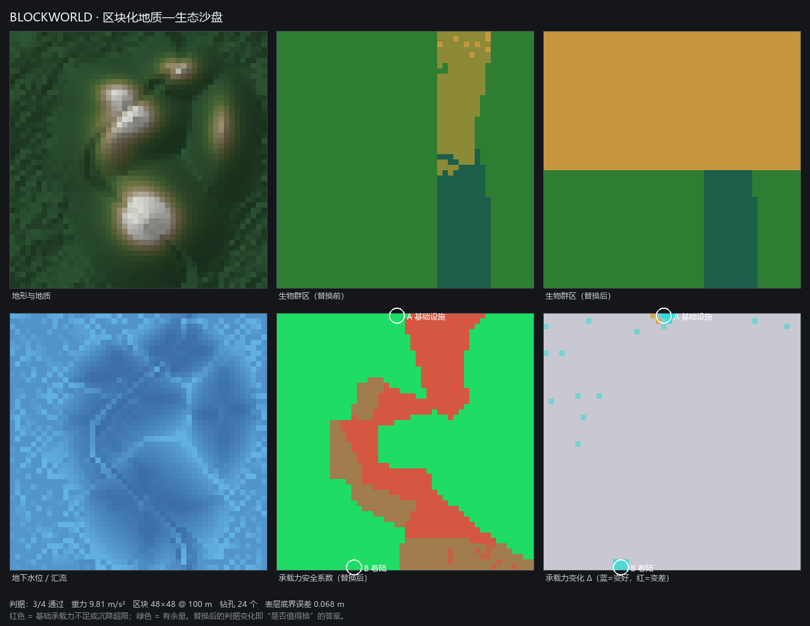

# blockworld

[](https://github.com/Xbotsd/blockworld/actions/workflows/ci.yml)
[](LICENSE)
[](pyproject.toml)

**If I replace this ground, does the answer change — and does it stay changed when the inputs are uncertain?**

This repository is a block-level sandbox for that question. A site is discretised
into blocks; each block holds a layered geological column, a climate, a water
table, a vegetation community and an animal population. An intervention —
ground replacement, dewatering, vegetation change, a different local gravity —
is applied to a set of blocks, and the result is scored against explicit
feasibility criteria: bearing capacity, settlement, slope stability, lander
footpad capacity, ecological sustainability.

```python
from blockworld import Criteria, Intervention, Study
from blockworld.io import load_site

study = Study(
    site=load_site("data/site/site.json"),
    criteria=Criteria(purposes=("infrastructure", "landing")),
    interventions=(Intervention("换填 8 m 砂砾", [
        {"op": "material", "material": "gravel_dense",
         "top_depth": 0, "bottom_depth": 8, "region": {"kind": "all"}}]),),
)
study.run().flips()   # [{'intervention': '换填 8 m 砂砾', 'criterion': 'infrastructure',
                      #   'passed_before': False, 'passed_after': True, ...}]
```

The verdicts are computed, not asserted: Vesic/Terzaghi capacity, elastic
settlement, infinite-slope stability, footpad bearing with dynamic amplification,
and a cohort-competition vegetation model feeding an energy-constrained animal
model. Every criterion returns a normalised `margin`, so interventions can be
compared and uncertainty can be propagated.



*Six panels from `blockworld demo`: terrain, biomes before and after a vegetation
change, water table, bearing-capacity factor of safety, and the change in that
factor induced by the ground improvements (blue = improved).*

## Start here

| if you want to… | read |
|---|---|
| understand what the numbers mean and which are trustworthy | [`docs/PROVENANCE.md`](docs/PROVENANCE.md) |
| use it, command by command | [`docs/GUIDE.md`](docs/GUIDE.md) |
| see the module boundaries and the data flow | [`docs/ARCHITECTURE.md`](docs/ARCHITECTURE.md) |
| read Chinese | [`docs/使用说明.md`](docs/使用说明.md) |
| know the exact CSV / JSON schema | [`data/README.md`](data/README.md) |

Sixty seconds:

```bash
pip install -e .
blockworld template data/site                          # editable dataset
blockworld study examples/study_landing.json --out out_study --mc 60 --morris 6
blockworld demo --out out                              # 48×48 site, ~13 s
python -m unittest discover -s tests                   # 69 tests
```

## What it does and does not claim

| | |
|---|---|
| **does** | compare interventions on one site; propagate input uncertainty; find which parameters actually move the verdict; refuse physically meaningless parameter sets |
| **does not** | predict a real site; replace a site investigation; model dynamics (consolidation, liquefaction, seismic time history); represent a real ecosystem |

The parameter layer is explicitly order-of-magnitude: ecological and hydrological
constants are settings, not calibrations, and synthetic sites are labelled
`synthetic` in provenance. Absolute numbers should not be quoted; comparisons
between interventions on the same site are what the package is for.
See [`docs/PROVENANCE.md`](docs/PROVENANCE.md) for a per-quantity classification.

## How a verdict is computed

| criterion | model | fails when |
|---|---|---|
| infrastructure | `qu = c·Nc·sc·dc + q·Nq·sq·dq + ½·γ·B·Nγ·sγ·dγ`, then `FS = qu / q_applied` | `FS < 3` or settlement > 25 mm or site slope > 20° |
| slope | `FS = [c + (γz·cos²β − u)·tanφ] / (γz·sinβ·cosβ)` | `FS < 1.3` on the worst block |
| landing | footpad pressure `p = m·g/(n·A)`, dynamic factor `1 + a/g`, compared to `qu` | `FS < 2`, penetration > half the leg stroke, or deceleration > limit |
| ecology | vegetated fraction, biome diversity, animal population | coverage < 60 %, fewer than 2 biomes, or an unsustainable animal community |

`margin` is the minimum normalised slack across the sub-criteria; `≥ 0` means it
passes. A `flip` is a change of sign between baseline and intervention.

## Uncertainty: probability, not a single factor of safety

A monotone sweep of a deterministic model yields a rank correlation of ±1 — that
is arithmetic, not information. This package reports the two things that survive
contact with a decision:

```python
from blockworld import Distribution, Parameter, monte_carlo, morris

params = [
    Parameter("clay c", {"kind": "material_prop", "material": "clay_soft", "prop": "c"},
              Distribution("uniform", 8, 40)),
    Parameter("pad diameter", {"kind": "lander", "field": "pad_diameter"},
              Distribution("uniform", 0.2, 0.9)),
]

mc = monte_carlo(study, params, n=200, seed=1, intervention=study.interventions[0])
mc.baseline["infrastructure"]["p_fail"]        # 1.00 before the intervention
mc.intervention["infrastructure"]["p_fail"]    # 0.00 after

mr = morris(study, params, r=6, seed=1, intervention=study.interventions[0])
mr.ranking("landing")[0]                       # who actually controls the verdict
```

Morris gives `mu*` (magnitude of influence), `sigma` (non-linearity or
interaction) and a rank, from `r·(p+1)` evaluations — a screening, not a variance
decomposition.

## Example: the shipped study

`examples/study_landing.json` on the template site, `--mc 60 --morris 6`:

| | baseline | after 8 m gravel replacement |
|---|---|---|
| infrastructure | fail (margin −5.99, settlement-controlled) | pass (+0.62) |
| landing | fail (−0.75) | fail (−0.77) |
| P(fail), infrastructure | 1.00 | 0.00 |
| P(fail), landing | 0.38 | 0.35 |

The landing criterion does not improve, because the replacement does not overlap
the landing site and a 3000 kg lander on three 0.25 m pads is marginal at Earth
gravity. That is the intended behaviour: criteria are pinned to sites, so a
treatment elsewhere cannot make a global question pass by accident.

## Extending it

```python
from blockworld import solvers

solvers.register_property("bearing_qu", my_plaxis_solver)   # one formula
solvers.register_criterion("landing", my_verifier)          # one whole criterion
```

`Study`, the uncertainty layer and the report keep working; the active registry is
recorded in `meta.solvers` so a result stays traceable to the solver that produced
it.

## Repository layout

```
src/blockworld/     site · io · geology · materials · world · edits
                    hydrology · vegetation · animals · verifiers
                    solvers · api · uncertainty · report · cli
tests/              69 tests (closed-form checks, IO contracts, refusal behaviour)
data/site/          editable template dataset
examples/           study configuration
docs/               GUIDE · ARCHITECTURE · PROVENANCE · 使用说明
tools/              world diagnostics, README snippet checker
figures/            generated figures
```

## Citation

If you use this software, cite it as described in [`CITATION.cff`](CITATION.cff).
A Zenodo DOI will be minted for the first archived release.

## License

MIT — see [`LICENSE`](LICENSE).
